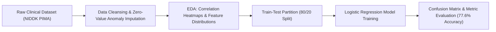

# 🩺 PIMA Indians Diabetes Classification — ML Pipeline

<p align="center">
  
</p>

<p align="center">
  An end-to-end Machine Learning diagnostic classification pipeline predicting diabetes onset using clinical diagnostic indicators, zero-value anomaly preprocessing, and an evaluated Logistic Regression model achieving <b>77.6% test accuracy</b>.
</p>

<p align="center">
  <a href="https://github.com/prakruthidevanga/PIMA-Indians-Diabetes-Logistic-Regression-">
    
  </a>
</p>

<p align="center">
  
  
  
  
</p>

---

## 📌 Table of Contents

- [📖 Project Overview](#-project-overview)
- [🎯 Objectives](#-objectives)
- [📊 Verified Results & Evaluation Metrics](#-verified-results--evaluation-metrics)
- [🔬 Machine Learning Workflow](#-machine-learning-workflow)
- [🛠️ Technology Stack](#️-technology-stack)
- [📁 Repository Structure](#-repository-structure)
- [⚙️ Installation and Setup](#️-installation-and-setup)
- [⚠️ Ethical & Clinical Disclaimer](#️-ethical--clinical-disclaimer)
- [🔮 Future Enhancements](#-future-enhancements)
- [🤝 Contributing](#-contributing)
- [👩‍💻 Author & Accreditations](#-author--accreditations)

---

## 📖 Project Overview

Early detection of chronic metabolic conditions like type 2 diabetes significantly reduces long-term vascular complications. Clinical diagnostic datasets frequently contain physiological anomalies (such as biologically implausible zero values for blood pressure, glucose, or BMI) that require careful data preparation before model training.

This project implements an end-to-end Machine Learning classification workflow on the **National Institute of Diabetes and Digestive and Kidney Diseases (NIDDK) PIMA Indians Diabetes Dataset**. The analysis conducts data hygiene, exploratory correlation modeling, feature scaling, and evaluates a Logistic Regression baseline model across standard diagnostic classification metrics.

🩺 **Core Mission:** Construct an explainable, transparent baseline machine learning pipeline for clinical screening risk prediction.

---

## 🎯 Objectives

- 🧹 **Resolve Physiological Data Anomalies:** Detect and handle zero-value entries in glucose, insulin, skin thickness, and BMI records.
- 🔍 **Uncover Correlation Signatures:** Quantify feature correlations against diabetes outcome to isolate primary risk factors.
- ⚖️ **Train-Test Evaluation:** Evaluate model generalization on an independent test split ($n = 192$).
- 📊 **Comprehensive Metrics:** Report full precision, recall, F1-score, and confusion matrix diagnostics rather than relying solely on raw accuracy.

---

## 📊 Verified Results & Evaluation Metrics

The model was evaluated on an independent test partition ($n = 192$ samples). The numerical results below reflect the executed notebook outputs:

| Evaluation Metric | Verified Value | Clinical Significance |
| :--- | :---: | :--- |
| **Overall Accuracy** | **77.6% (0.776)** | Reliable baseline screening capability |
| **Precision (Non-Diabetic - Class 0)** | **0.80** | High confidence when predicting negative diagnosis |
| **Recall (Non-Diabetic - Class 0)** | **0.88** | Reliably rules out low-risk profiles |
| **F1-Score (Non-Diabetic - Class 0)** | **0.84** | Strong balance for majority class |
| **Precision (Diabetic - Class 1)** | **0.69** | Favorable positive predictive value |
| **Recall (Diabetic - Class 1)** | **0.55** | Identifies more than half of true positive cases |
| **F1-Score (Diabetic - Class 1)** | **0.61** | Harmonized diabetic evaluation measure |

---

## 🔬 Machine Learning Workflow



---

## 🛠️ Technology Stack

<p align="center">
  
</p>

| Component | Technology | Implementation Role |
| :--- | :--- | :--- |
| **Language & Environment** | Python 3.9+ | Pipeline assembly and scientific computing |
| **Machine Learning** | Scikit-learn | Logistic regression, train-test split, classification report |
| **Data Manipulation** | Pandas, NumPy | Anomaly detection, null value handling, data normalization |
| **Visualizations** | Matplotlib, Seaborn | Correlation heatmaps, feature pairplots, ROC curve plotting |

---

## 📁 Repository Structure

```text
PIMA-Indians-Diabetes-Logistic-Regression-/
├── Logistic Regreesion dataset.ipynb   # Complete analysis, visualizations, and model training
└── README.md                           # Project documentation
```

---

## ⚙️ Installation and Setup

### Prerequisites
- Python 3.8+
- Jupyter Notebook or JupyterLab

### Running the Notebook:
```bash
git clone https://github.com/prakruthidevanga/PIMA-Indians-Diabetes-Logistic-Regression-.git
cd PIMA-Indians-Diabetes-Logistic-Regression-
python -m venv .venv
.\.venv\Scripts\Activate.ps1
pip install pandas numpy scikit-learn matplotlib seaborn jupyter
jupyter notebook "Logistic Regreesion dataset.ipynb"
```

---

## ⚠️ Ethical & Clinical Disclaimer

*This application is an educational and academic machine learning project. The predictions generated are computational statistical outputs based on historical data distributions and do not constitute certified medical diagnoses or clinical treatment plans.*

---

## 🔮 Future Enhancements

- 🌲 **Tree Ensemble Comparison:** Benchmark Random Forest, XGBoost, and LightGBM models.
- 🎯 **Decision Threshold Tuning:** Adjust the classification threshold to increase positive recall for medical screening contexts.

---

## 🤝 Contributing

Contributions, feature engineering proposals, and model benchmarks are welcomed!

---

## 👩‍💻 Author & Accreditations

**Prakruthi B R**  
*BCA Student specializing in Artificial Intelligence & Machine Learning*  
*Alliance University, Bengaluru (CGPA: 9.60)*  
*GeeksforGeeks Campus Mantri (2026)*

- 💻 **GitHub:** [@prakruthidevanga](https://github.com/prakruthidevanga)
- 🔗 **LinkedIn:** [Prakruthi BR](https://linkedin.com/in/prakruthi-br)
- 🌐 **Portfolio:** [prakruthidevanga.github.io](https://prakruthidevanga.github.io/)
- 📬 **Email:** [prakruthibr2006@gmail.com](mailto:prakruthibr2006@gmail.com)

---

<p align="center">
  <b>🩺 Advancing predictive health intelligence through transparent machine learning.</b>
</p>

<p align="center">
  
</p>
