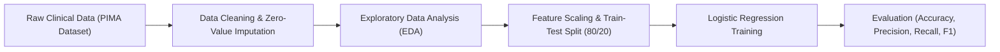

# 🩺 PIMA Indians Diabetes Classification — Logistic Regression Pipeline

An end-to-end Machine Learning exploratory data analysis and classification pipeline predicting diabetes onset in PIMA Indian women using Python, Pandas, Scikit-learn, and Seaborn.

---

## 📌 Project Overview

This machine learning project builds and evaluates a binary classification model to predict whether a patient is likely to develop diabetes based on clinical and physiological diagnostic measurements from the National Institute of Diabetes and Digestive and Kidney Diseases (NIDDK) Pima Indians Diabetes Dataset.

### Core Objectives:
- **Data Preprocessing & Cleaning:** Handle zero-value anomalies across diagnostic variables (glucose, blood pressure, insulin, BMI).
- **Exploratory Data Analysis (EDA):** Uncover feature distributions, correlation heatmaps, and relationships between BMI, age, glucose, and diabetes outcome.
- **Model Training & Evaluation:** Train a Logistic Regression baseline model and assess performance using a confusion matrix and classification metrics.

---

## 🏗️ Machine Learning Workflow



---

## 📊 Verified Results & Evaluation

The model was evaluated on an independent test split (`n = 192` samples). The verified experimental results obtained from execution are:

| Metric | Score / Value |
| :--- | :--- |
| **Overall Accuracy** | **77.6% (0.776)** |
| **Precision (Non-Diabetic - Class 0)** | **0.80** |
| **Recall (Non-Diabetic - Class 0)** | **0.88** |
| **F1-Score (Non-Diabetic - Class 0)** | **0.84** |
| **Precision (Diabetic - Class 1)** | **0.69** |
| **Recall (Diabetic - Class 1)** | **0.55** |
| **F1-Score (Diabetic - Class 1)** | **0.61** |
| **Weighted Average F1** | **0.77** |

### Key Clinical Insights:
1. **Glucose Level** demonstrated the strongest positive correlation with diabetes diagnosis.
2. **BMI and Age** served as significant secondary predictive indicators.
3. High recall (88%) on negative cases helps reliably rule out low-risk profiles, while threshold tuning can further improve diabetic recall for clinical screening.

---

## 📂 Repository Structure

```text
PIMA-Indians-Diabetes-Logistic-Regression-/
├── Logistic Regreesion dataset.ipynb   # Complete analysis, visualizations, and model training
└── README.md                           # Project documentation and verified benchmarks
```

---

## ⚙️ Installation & Usage

### Prerequisites
- Python 3.8+
- Jupyter Notebook or JupyterLab

### Running the Notebook:

1. **Clone the repository:**
   ```bash
   git clone https://github.com/prakruthidevanga/PIMA-Indians-Diabetes-Logistic-Regression-.git
   cd PIMA-Indians-Diabetes-Logistic-Regression-
   ```

2. **Install dependencies:**
   ```bash
   pip install pandas numpy matplotlib seaborn scikit-learn jupyter
   ```

3. **Launch the notebook:**
   ```bash
   jupyter notebook "Logistic Regreesion dataset.ipynb"
   ```

---

## 🛠️ Technology Stack

- **Language:** Python
- **Data Manipulation:** Pandas, NumPy
- **Visualizations:** Matplotlib, Seaborn
- **Machine Learning:** Scikit-learn (`LogisticRegression`, `accuracy_score`, `confusion_matrix`, `classification_report`)
- **Environment:** Jupyter Notebook

---

## 👩‍💻 Author & Contributions

- **Author:** Prakruthi B R ([@prakruthidevanga](https://github.com/prakruthidevanga))
- **Role:** Individual developer — performed EDA, built data cleaning routines, trained the logistic regression classifier, and evaluated diagnostic metrics.
